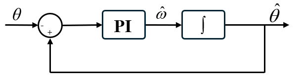

# 编码器量化噪声

## 1. 编码器量化噪声

假设编码器每圈有效计数为 $C$，对于 $N$ 位绝对式编码器：$C = 2^N$；角度分辨率：$q_\theta = \frac{2\pi}{C}$。

量化后的角度：
$$
\theta_q(k) = \theta(k)+e_q(k)
$$
对于理想的四舍五入量化器：
$$
-\frac{q_\theta}{2} \leq e_q(k) \leq \frac{q_\theta}{2}
$$
假设真实角度在量化区间内均匀分布，则：
$$
E(e_q) = 0 \\
\sigma_\theta = \frac{q_\theta}{\sqrt{12}}
$$
如果使用差分的方式计算速度，则：
$$
\hat\omega(k) = \omega(k)+\frac{e_q(k)-e_{q}(k-1)}{T_s}
$$
如果相邻量化误差近似独立，则：
$$
\sigma_\omega=\frac{q_\theta}{\sqrt{6}T_s}
$$
高采样频率会带来更大的量化噪声。

> 当每个采样周期内的真实角度增量小于一个码，这导致相邻编码器读数大多时候不会发生变化，但是一旦跨越量化边界，则会导致瞬时速度抖动很大。
>
> 速度输出通常是：0，0，0，$\frac{q_\theta}{T_s}$，0，0。跳变频率为 $f_{edge}=\frac{|\omega|}{q_\theta}$。
>
> 量化噪声频谱常在 $f_{edge}$ 及其谐波处出现尖峰，不一定是平坦白噪声。

> 从频域来看，差分环节的传递函数为：
> $$
> H(z) = \frac{1-z^{-1}}{T_s}
> $$
> 其频率响应：
> $$
> |H(e^{j\Omega})|=\frac{2}{T_s}\sin(\frac{\Omega}{2})
> $$
> 相当于高通滤波器，该滤波器会放大量化误差的高频成分。

## 2. 改进测速方法

### 锁相环

锁相环结构如下：

锁相环是二阶系统，因此角度线性增加时其误差为 0，因此得到的速度趋近于真实速度。
$$
K_p = 2\zeta\omega_n \\
K_i = \omega_n^2
$$
一般取 $\zeta = 0.707$，$\omega_n$ 为带宽，一般需要取速度环带宽的 2-5 倍以保证跟踪动态。同时带宽需要低于采样频率。

### $\alpha$-$\beta$ 法

首先进行预测：
$$
\theta_p(k) = \hat\theta(k-1)+T_s\hat\omega(k-1) \\
\omega_p(k) = \hat\omega(k-1)
$$
计算角度残差：
$$
r(k) = \theta(k)-\theta_p(k)
$$
角度和速度修正：
$$
\hat\theta(k)=\theta_p(k)+\alpha r(k) \\
\hat\omega(k) = \omega_p(k)+\frac{\beta}{T_s}r(k)
$$
$\alpha$ 为角度修正增益，$\beta$​ 为速度修正增益。$\alpha$ 越大，估计角度越相信编码器测量，$\beta$ 越大，角度残差对速度的修正越强；参数越大，响应越快，但量化噪声越明显，参数越小，输出越平滑，但加减速跟踪更慢。

稳定条件为：
$$
0<\alpha<2\\
0<\beta<4-2\alpha
$$
一般取在 0-1 范围内。

可以按照带宽计算参数：
$$
r = e^{-\zeta\omega_nT_s} \\
\phi = \omega_n\sqrt{1-\zeta^2}T_s \\
\alpha = 1-r^2 \\
\beta = 1+r^2-2r\cos\phi
$$
本质上，该方法是 PLL 的yi'z